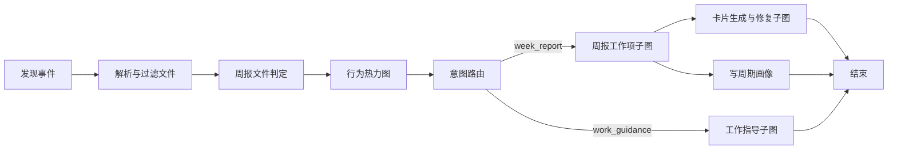

# 新运行协议的业务落地分析

日期：2026-10-08。状态：设计分析，尚未实现新协议。

基线：eino-viewer `417a6b1`、cloud-focus `d360bf3`、suggest-platform `473e6b8` 的本地代码。核对范围为真实运行、采集与存储、平台消费三条链路；没有访问线上数据库、配置或生产服务。

用户已选择：优先完整迁移功能，允许集中升级采集端；本次以不受旧格式约束的规范化 RunRecord 方案为基础。旧的 [兼容优先草案](./PROTOCOL_DECISION_2026-10-08.md) 保留为历史审计，本文取代其中的协议方向建议。

## 1. 结论与设计边界

保留 `run / definitions / invocations / events / relations / contents / usage / annotations / optional sourceRecords` 的方向。业务核对要求补充六个明确约束：

1. **Run 必须声明运行边界。** cloud-focus 的推荐引擎生成、内部 Workflow 执行、宿主卡片交付，具有不同的成功语义。
2. **Invocation 只记录实际发生的调用。** 未选分支、已经调用但业务软停止、无需修复，是三种不同事实。
3. **LLMClient 是必需的采集边界。** 业务 Lambda 内的每次模型请求都要独立记录；仅接 Eino 回调不够。
4. **保留独立 metrics、业务诊断和业务产物。** 当前平台的过滤漏斗、168 格热力图、周报时间窗、评测材料都不能降格为一段通用日志。
5. **输入包含显式参数和实际读取的上下文。** Local State、有效模型配置、脱敏与缺失情况必须可表达。
6. **迁移覆盖正式消费者。** DAG、详情、成本、统计、评测、点击关联与预览都要更新。

协议核心不内置 `weekly_report` 的业务规则。提供独立版本的 `cloud-focus` 扩展规范，约定意图、软停止原因、结果 schema、评测上下文等。平台按扩展 schema 注册面板和统计投影。

本次仍以保存后查看一次运行的静态结果为目标。流式模型调用的最终内容、部分失败内容属于采集范围；实时 Viewer、流式网络传输、恢复执行不因此成为本轮必做功能。Agent、可回环 Graph、Workflow 的既有 Viewer 功能仍须保留，不能因为当前业务主要使用 Workflow 而收窄通用模型。

## 2. 现行链路与 Run 边界

### 2.1 当前真正的生产代码路径

```text
Focus /get/v2 缓存未命中，或 cron worker
  → 宿主创建 taskId，取得用户凭据
  → GenerateSuggest：准备宿主依赖与配置
  → recommend.Service.Generate
      → BuildWorkflow：同时取得本次编译定义
      → Workflow.Invoke：节点与嵌套图执行
      → 整理引擎结果；部分“无材料”错误转为空结果成功
      → 同步保存 task_diag；保存错误不改变生成返回值
  → 宿主过滤、映射可展示卡片
  → 写 Focus 业务 DB、ready cache，更新 job 结果
```

`GenerateSuggest` 本身是同步调用，V2 的异步边界在外层 goroutine。`persistSyncGenerateTaskDetail` 目前只记录日志；旧异步 helper 不是现行写库主路径。当前诊断主体写入 `recommend_task_diag`，其中 `dag_metrics` 实际存的是 WorkflowSnapshot。

依据：[宿主入口](/Users/tkxiong/Code/suggest/cloud-focus/internal/service/suggest_context.go:72)、[V2 异步边界](/Users/tkxiong/Code/suggest/cloud-focus/internal/service/focus/get_v2.go:302)、[引擎运行](/Users/tkxiong/Code/suggest/cloud-focus/internal/recommend/runner/suggest_weekly_report.go:63)、[诊断存储](/Users/tkxiong/Code/suggest/cloud-focus/internal/service/suggest_task_diag_store.go:25)。

### 2.2 推荐决定：一次 Generate 为引擎 Run，关联宿主 Task

- `runId` 标识一次 `recommend.Service.Generate` 调用；`taskId` 为宿主关联 ID。同一 task 重试产生新 run，不能覆盖前次。
- 引擎 Run 的 root invocation 是应用操作 `recommend.Generate`，其下才是 Workflow invocation；root 不要求一定有 Eino 定义引用。
- 在 facade 校验、编译之前建立 root，因此参数错误、编译失败也有明确的失败运行。未进入 Generate 的凭据获取错误由宿主 task/job 记录，不伪造 Workflow invocation。
- root 的 finalize/export/store 所有权一起上移到 facade；runner 贡献子执行与业务结果，移除原 runner 层的终态保存职责，避免 root 尚未结束便保存或重复保存。
- 宿主 task/job/delivery 独立维护结果并引用 runId。平台详情可以同时显示“生成成功、零卡片”和“交付失败：无可展示卡片”。需要继续查看宿主过程时，可用同一通用模型建立另一 application run 并显式关联。
- 引擎 Run 在生成边界封存，不被后续点击、曝光或缓存结果改写。运行记录保存是否成功属于存储回执/宿主状态，不改变 execution outcome。

这是实有业务差异：runner 将 `ErrNoDocuments / ErrNoMaterials / ErrNoRankedDocs` 收敛为 `[]items, nil`，但内部 Workflow 可以已失败；V2 映射为空会走失败处理，cron 缓存写失败也记失败。业务 DB 写失败目前只打日志，缓存成功仍可能交付成功。

依据：[空结果收敛](/Users/tkxiong/Code/suggest/cloud-focus/internal/recommend/runner/suggest_weekly_report.go:248)、[V2 卡片映射](/Users/tkxiong/Code/suggest/cloud-focus/internal/service/focus/get_v2.go:355)、[cron 交付状态](/Users/tkxiong/Code/suggest/cloud-focus/internal/service/focus/get_v2_worker.go:114)、[业务 DB 保存](/Users/tkxiong/Code/suggest/cloud-focus/internal/service/focus/get_v2_persist.go:26)。

## 3. 真实 Workflow 决定的语义

### 3.1 定义、数据关系和实际激活分开



上图是业务控制关系简图。底层还存在字段映射、无直接依赖的数据输入，以及 END 等待关系，不能靠这张简图重建完整定义。

- `definitions` 来自**同次编译取得的 GraphInfo**；NodeSpec 只补业务名称、语义类别和角色。
- 两条内容臂接收 router 数据时使用 `WithNoDirectDependency()`，实际激活由 `AddBranch` 决定。定义边至少区分控制、执行依赖、数据映射。
- `relations` 表示已观测的运行关系；不能把所有定义边转换为发生过的调用因果，也不能把并发日志先后顺序当作依赖。
- router 记录请求意图、有效策略、实际选择目标和原因。请求 ForceIntent、UID override、ForceReportPrep 有优先级；最终 selector 还可能对 nil/未知输入 fallback 到 week_report。
- 请求的 `week_review/week_review_hook` 当前会映射为 work_guidance；`SkipWeekdayCheck` 已不影响实际 Intent。业务 `now_unix` 与执行开始时间分别记录。

实际 decision 必须就地固化，不能直接采用最终 `GenerateMetas.Intent`：当前空 END 会经 PickBranchState 产生 synthetic `IntentSilent`，结果整理随后可能覆盖已取得的 RoutedIntent。因此“router 已运行、下游硬失败、END 为空”也必须保留先前选择的真实分支，不把它改写成 silent。

依据：[编译定义](/Users/tkxiong/Code/suggest/cloud-focus/internal/recommend/scenes/weekly_report/workflow.go:125)、[分支与 END](/Users/tkxiong/Code/suggest/cloud-focus/internal/recommend/scenes/weekly_report/workflow.go:289)、[意图优先级](/Users/tkxiong/Code/suggest/cloud-focus/internal/recommend/scenes/weekly_report/nodes/node_intent_router.go:86)、[当前策略](/Users/tkxiong/Code/suggest/cloud-focus/internal/recommend/scenes/weekly_report/policy/intent.go:59)。

空 END 依据：[PickBranchState](/Users/tkxiong/Code/suggest/cloud-focus/internal/recommend/scenes/weekly_report/state/pick_branch_state.go:25)、[最终意图覆盖](/Users/tkxiong/Code/suggest/cloud-focus/internal/recommend/runner/suggest_weekly_report.go:253)。

### 3.2 不用一个 status 混合执行与业务判断

| 真实场景 | Invocation 事实 | 业务扩展/关联 |
| --- | --- | --- |
| 分支未选中 | 没有该节点的 invocation | decision 指向已选目标；未选定义显示解释 |
| 下游继承 SkipInfo | 节点确实调用并正常返回，模型请求为零 | soft-stop、首个原因及其 origin invocation |
| 卡片有效，无需修复 | repair 节点仍执行，模型请求为零 | repair count = 0、无需修复 |
| 模型返回成功，卡片解析失败 | 模型调用 succeeded；卡片节点可正常返回 | validation failed、needs repair；保留原始响应 |
| 工作项模型内容格式错误 | 模型调用 succeeded 且可有 usage，parser 返回 format_error 与 nil error | 下游 no_work_items 软停止；不走卡片格式修复 |
| 格式修复调用 | repair 节点下有逐次模型 invocation | 现行两臂最多修复 1 次；helper 与协议支持 N 次，每次独立保存输入、输出、校验和 repairs 关系 |
| 摘要/正文读取失败但继续 | 对应业务节点可以 succeeded | dependency warning、降级原因，不强行把整个 run 判失败 |
| 无文档在节点内返回 error | 节点和 Workflow failed；Generate 可 succeeded | empty-result 及原始 cause；产出数量为零 |
| 周期画像写失败但仍出卡 | 业务节点正常返回 | 画像写入失败 annotation；不覆盖推荐结果 |

核心 outcome 表达调用是否成功完成、失败或取消；业务决策使用带 schema 的 annotation。不能把 `skipped` 同时解释成“没有调用”“正常短路”和“上游失败”。

依据：[首个软停止原因](/Users/tkxiong/Code/suggest/cloud-focus/internal/recommend/scenes/weekly_report/state/skip.go:11)、[卡片解析与修复触发](/Users/tkxiong/Code/suggest/cloud-focus/internal/recommend/scenes/weekly_report/nodes/llm_card_shared.go:66)、[修复循环](/Users/tkxiong/Code/suggest/cloud-focus/internal/recommend/scenes/weekly_report/nodes/node_card_format_repair.go:56)。

工作项解析与修复上限依据：[工作项 parser](/Users/tkxiong/Code/suggest/cloud-focus/internal/recommend/scenes/weekly_report/strategy/work_items_output_parser.go:25)、[当前最大修复次数](/Users/tkxiong/Code/suggest/cloud-focus/internal/recommend/scenes/weekly_report/strategy/card_format_repair_prompt.go:17)。

### 3.3 具体的调用记录应长这样

```text
recommend.Generate                     succeeded，产生推荐卡片
  Workflow.Invoke                      succeeded
    week_report_recommend              succeeded
      week_report_llm_card             succeeded，校验失败，要求修复
        model call #1                  succeeded，独立 request/response/usage
      week_report_card_format_repair   succeeded，修复成功
        model call #2                  succeeded，独立 request/response/usage
      enrich                           succeeded，业务过滤后的结果
```

这是目标语义示例，不是线上样本。两个模型请求均成功返回，不能把第一次的解析错误伪装成模型传输失败。最终推荐结果、enrich 诊断和原始模型文本是不同 content。

## 4. 对规范化协议的具体补充

下表为应冻结的语义要求；字段拼写可在 JSON Schema/Go/TypeScript 合同阶段统一。新格式应有独立 major 标识，不让原 `schemaVersion: 1 + evidence` 与规范化实体共享同一判别值。

| 实体 | 本次业务核对要求 |
| --- | --- |
| run | rootInvocationId、明确 scope、生命周期、capture coverage；taskId/uid/corpId/scene 为宿主上下文。协议版本、PipelineVersion、宿主配置/实验版本分别表示 |
| definitions | 图包含关系、节点稳定身份、component 与 semanticKind 分开；数据映射、分支候选和依赖。允许有环 Graph；应用 root 可无定义 |
| invocations | 独立 ID、parent invocation、definitionRef 可选、实际起止时间/耗时、终态、错误、I/O 引用；**独立 metrics** 保留计数、标记、单位，不能只剩 token |
| events | 生命周期、实际 route decision、validation 等已发生事实；eventId、owner、采集 sequence 与时间。sequence 只表示采集顺序，因果由 relations 表示 |
| relations | containment、实际因果、读取状态版本、修复/派生产物等有来源的关系；不从名称、数组邻接或静态边猜测 |
| contents | 稳定 ID、owner、角色、媒体/schema 类型、inline 或受控引用、采集来源、完整度、脱敏/截断/未采集原因；区分实际请求、Wire I/O、状态、业务产物、派生诊断 |
| usage | 一次实际模型请求一条账本事实，绑定 invocation、有效 provider/model；input/output/cache/reasoning/total 的包含关系、计量来源与完整度明确。unknown 不填 0 |
| annotations | 带 namespace、type、schemaVersion、owner、payload/contentRef；承载 cloud-focus 意图、软停止、诊断、评测上下文等。错误诊断与业务诊断不混用 |
| sourceRecords | 可选原始 Eino、旧快照等来源证据；缺少这些也必须能读规范化运行，不承担核心身份、父子或计费语义 |

运行内所有引用必须可解析，父调用关系无环；定义身份与调用身份不混用。同一模型调用的所有 observation 汇入同一个 invocation。父图用量仅为派生汇总，不能再作为账本项相加。纯定义、未完整采集、无业务诊断均允许表达，但不能宣称为完整运行。

业务扩展示例包括 `cloud-focus.route-decision@1`、`cloud-focus.soft-stop@1`、`cloud-focus.weekly-report.result@1`、`cloud-focus.evaluation-context@1`；这是建议的规范名称，不是已存在的实现。

## 5. cloud-focus 采集端：复用什么、补采什么

### 5.1 采集改造位置

| 层级 | 可复用的现状 | 必须补充的工作 |
| --- | --- | --- |
| recommend 公共入口与 runner | 业务请求、编译图、结果收敛与保存端口 | facade 前段创建 run/root，统一 finalize/export/store；runner 贡献子执行并撤下旧保存职责；返回 RunRecord，保留原始错误与收敛结果；preview 同样返回内存记录 |
| Eino collector | 已有节点回调、GraphInfo、嵌套路径 | 每次调用独立身份、父子、起止与 I/O；由 invocation 关联 observation，结束后不能按末级名称拼接 |
| 现有 recorder | 各节点的 metrics/diagnostics 提取函数 | 作为业务投影复用；从 `stepsByName/diagnosticsByID` 升级到 invocation owner，保留未知扩展 |
| router selector | 真正返回已选分支的位置 | 补 route decision、effective intent、fallback、override 来源 |
| LLMClient.Generate | 业务统一模型端口 | 每次真正调用开始/结束各一次，关联业务父节点；修复循环自然成为多次调用 |
| 宿主模型实现 | mergeGenerate 有有效配置，observed model 已观察流 | 用同一 invocation 补有效模型/参数、usage、partial response；不再建一份重复模型调用 |
| Local State helper | 关键事实写入和读取集中在 helper | 白名单状态快照、版本与 writer/reader 引用；使用短临界区复制，锁外序列化 |
| 错误/降级分支 | 部分节点已有 DiagCapture | 在 error return/吞错之前固化有价值的部分诊断与错误原因 |

宿主仍只通过 `recommend` 公共 facade 接入中立采集端口；scene 不引入数据库/平台依赖。不为采集而把确定性 Workflow 改造成 Agent，也不把每个 parser 或 helper 变成 DAG 节点。

### 5.2 LLM 是当前最明确的采集缺口

模型请求发生在 Eino Lambda 内部，经 `domain.LLMClient.Generate → service.llmClient → StreamGenerate` 执行；LLMClient 还允许其他实现。因此 Eino 节点回调无法独自给出修复循环内每次模型请求。

推荐在 LLMClient 边界创建 invocation，在宿主合并参数和现有流观察器中丰富同一条调用。当前 StreamGenerate 遇到中流错误、content_filter 等会返回 `nil, error`，上游拿不到已收到的部分内容和用量，必须在已有流消费路径保存这些事实，不能额外消费一遍流。观察器的原始错误也不能替代最终业务边界错误，例如 finish_reason 需要由汇总层判定。

已有 `LLMInputDiag` 往往是重建的脱敏 user input，system prompt 只留长度，正文被清空。它可以继续支持诊断，但不得标注为“完整真实请求”；真实 messages 与派生诊断分别保存。修复路径的采集策略也需逐条明确，不能假设所有 llm_input 都同样脱敏。

依据：[模型端口](/Users/tkxiong/Code/suggest/cloud-focus/internal/recommend/domain/ports.go:53)、[有效参数与调用](/Users/tkxiong/Code/suggest/cloud-focus/internal/service/llm_client.go:69)、[流消费](/Users/tkxiong/Code/suggest/cloud-focus/internal/infra/llm/stream.go:18)、[现有观察器](/Users/tkxiong/Code/suggest/cloud-focus/internal/infra/llm/observe.go:60)、[诊断输入重建](/Users/tkxiong/Code/suggest/cloud-focus/internal/recommend/scenes/weekly_report/nodes/llm_card_shared.go:100)。

### 5.3 不直接序列化所有 Go 入参

真实 Wire 同时存在无 JSON 排除标记的 `AccessToken`，以及 `json:"-"` 的 PromptContext/UserProfile。直接 marshal 会泄露不应采集的凭据，同时遗漏实际参与计算的上下文。共享 Local State 中还有 DocumentFacts、ReportDocuments、行为时间和用户画像；仅看 Wire 字段映射无法解释完整数据来源。

采用显式 capture projector：采集可读业务字段、明确排除凭据，对关键状态保存消费时快照与版本。不能在运行结束后才序列化共享指针；并行画像写入会修改共享对象，从而污染过去输入的含义。已被脱敏/未采集的值保留原因，不以空字符串代替未知。

依据：[Wire 字段](/Users/tkxiong/Code/suggest/cloud-focus/internal/recommend/scenes/weekly_report/state/wire_types.go:109)、[Local State](/Users/tkxiong/Code/suggest/cloud-focus/internal/recommend/scenes/weekly_report/state/runtime_state.go:89)、[状态读写 helper](/Users/tkxiong/Code/suggest/cloud-focus/internal/recommend/scenes/weekly_report/nodes/runtime_state.go:12)。

当前错误诊断也不完整：`resolve_files` 先算出全部过滤原因，再返回 ErrNoDocuments，但未 Stash；OnError 看不到 output，原因会丢。历史画像读取失败、用户画像失败等部分情况只留日志或 status。需要补采这些分支，不能以已有 DiagCapture 机制存在就宣称业务失败诊断完整。

依据：[resolve_files 返回错误](/Users/tkxiong/Code/suggest/cloud-focus/internal/recommend/scenes/weekly_report/nodes/node_resolve_files.go:60)、[recorder 错误边界](/Users/tkxiong/Code/suggest/cloud-focus/internal/recommend/scenes/weekly_report/recorder/recorder.go:122)。

## 6. suggest-platform：完整功能迁移清单

| 当前功能 | 新协议落点与迁移约束 |
| --- | --- |
| 任务状态/错误/耗时/Token 概览 | run 概览 + 宿主 task/delivery；明确显示每种状态所属边界 |
| DAG、嵌套图、展开/收起、四向布局、缩放 | definitions 与 invocations；这些 UI 控制继续由 Viewer API 提供 |
| 点击节点查看详情 | 选择 contract 返回 definitionRef + invocationId；定义未执行时仍能显示路由解释，不依赖末级 id 拼接 |
| 专用诊断面板 | 宿主按 schema/业务角色选择；保留 semanticKind，不能拿 Eino Lambda 代替业务 llm/io/branch 等类别 |
| 文件发现与过滤 | files、filtered_docs、原因/权限/大小/时间与计数，保留原类型和单位 |
| 行为排序与周报文件 | top/eliminated docs、score、行为时间窗、自然周统计、业务 now_unix |
| 行为热力图 | 完整 168 个 scores、k、t、业务时间与时区；不能简化为一个命中布尔值 |
| 摘要/正文/LLM 查看复制 | 专用 content 与 diagnostics；区分正文、元数据、实际请求、脱敏重建；未知 JSON 保留通用回退 |
| enrich 过滤与最终结果 | before/after、passed/filtered 独立诊断；完整且有序的引擎产物单独存，保留 raw tag code 和派生 label |
| 成本明细与分析 | 逐模型请求 usage → 统一计价投影；父级汇总不重复计费，失败请求也可有用量 |
| 失败率/结果率/耗时分位数 | 宿主查询投影，显式统计口径与业务阶段映射；并行子耗时不能相加当父墙钟耗时 |
| 评测选例、材料提取与结果评估 | 显式 effective intent、evaluation-context 与 engine result 引用；不再按诊断节点名称猜材料 |
| 曝光/点击与卡片回填 | 宿主业务事件关联 run + 稳定 item ID + delivery item ID；执行 events 不混入产品事件 |
| 来源切换、权限、任务导航、CSV | 保留在宿主；详情及引用 content 的读取均经过授权，run reference 包含来源 |

当前 TaskDetail 结果校验只展示 title/prompt/related_files，不能据此裁剪协议中的其他真实结果字段。graph 父节点按约定只有轻量 metrics、没有 diag 也是有效数据，不能标为采集异常。

依据：[TaskDetail](/Users/tkxiong/Code/suggest/suggest-platform/web/admin-web/src/trace/components/TaskDetail.vue:281)、[NodePanel 选择与状态](/Users/tkxiong/Code/suggest/suggest-platform/web/admin-web/src/trace/components/NodePanel.vue:13)、[热力图](/Users/tkxiong/Code/suggest/suggest-platform/web/admin-web/src/trace/components/node-panels/weekly_report/behaviorHeatmap.ts:27)、[结果校验](/Users/tkxiong/Code/suggest/suggest-platform/web/admin-web/src/trace/components/TaskDetail.vue:314)、[授权入口](/Users/tkxiong/Code/suggest/suggest-platform/internal/handler/recommend_diagnose.go:204)。

### 6.1 已存在的业务错位，迁移时不能照搬

**评测意图来源已经错位。** 当前 cloud-focus 把 intent/reason 放在 router metrics，diag 返回 nil；平台评测仍读 `node_diagnostics.intent_router.intent`，缺失时默认 week_report。平台评测仍以 week_report/week_review 分类，并读取旧 `week_review_llm`；当前引擎分支则为 week_report/work_guidance。按这条代码路径，guidance 记录可能被默认归入 week_report，或读不到预期材料。这是本地代码的接口不匹配结论，尚未核对线上受影响数据量。

因此 `cloud-focus` profile 必须正式定义 effective intent 和评测上下文，评测端迁移到这些引用；未知意图显示未知，不再默认伪装为周报。历史 week_review 保留带版本的映射，不能不分版本把全部旧记录认作新 guidance。

依据：[producer router observation](/Users/tkxiong/Code/suggest/cloud-focus/internal/recommend/scenes/weekly_report/recorder/recorder_observation.go:191)、[评测分类](/Users/tkxiong/Code/suggest/suggest-platform/internal/service/eval_case.go:16)、[材料提取](/Users/tkxiong/Code/suggest/suggest-platform/internal/service/eval_case.go:358)、[默认意图](/Users/tkxiong/Code/suggest/suggest-platform/internal/service/eval_case.go:410)。

**评测材料的结构也已不一致。** 当前 card input 输出 `documents` 与对象类型的 `user_profile`；平台提取器却读 `document_candidates` 并把 user_profile 解为 string。有画像时会导致整次上下文反序列化失败，没有画像时仍读不到 documents。新 evaluation-context 应显式保存结构化 `work_items / documents / user_profile / time_context`，注明内容来自真实请求还是脱敏诊断，不再从 prompt 文本反推业务材料。

评测的样本身份也必须固定：目前建 case 保存诊断快照，但实际评分再按 taskId 查询最新 result_items，可能将旧材料与新结果混用；新 case 引用不可变 runId、结果 artifact/version、itemId 和评分规则版本。case set、评测队列、人工标记和评分维度继续由平台维护。

依据：[当前卡片输入](/Users/tkxiong/Code/suggest/cloud-focus/internal/recommend/scenes/weekly_report/strategy/week_report_card_input_builder.go:33)、[画像对象](/Users/tkxiong/Code/suggest/cloud-focus/internal/recommend/scenes/weekly_report/strategy/user_profile.go:20)、[提取结构](/Users/tkxiong/Code/suggest/suggest-platform/internal/service/eval_case.go:396)、[评分结果来源](/Users/tkxiong/Code/suggest/suggest-platform/internal/service/case_eval/service.go:193)。

**多卡点击关联不能依赖标题回退。** 当前 recommend_trace 的点击查询不读取 title/extra，后续按标题匹配 result_items、找不到则取第一张，没有使用卡片序号定位。V1 交付 ID 使用下划线，V2 多卡使用 `taskId#index`、单卡直接使用 taskId；协议不能假定一种字符串拆解规则。引擎结果 profile 为每张卡提供稳定 itemId，宿主保存过滤、排序后的 delivery itemId → engine itemId 关系，点击和曝光引用明确对象。

依据：[平台点击查询](/Users/tkxiong/Code/suggest/suggest-platform/internal/infra/dao/recommend_click_dao.go:121)、[首卡回退](/Users/tkxiong/Code/suggest/suggest-platform/internal/infra/dao/recommend_click_dao.go:245)、[V1 ID](/Users/tkxiong/Code/suggest/cloud-focus/internal/service/suggest.go:226)、[V2 ID](/Users/tkxiong/Code/suggest/cloud-focus/internal/service/focus/get_v2.go:472)。

**费用统计也存在不同口径。** 前端按叶子调用的 prompt tokens 选档，后端先合计整任务 tokens，再按总量计价，且整个 task 只带一个 model_name；未知模型前端隐藏费用、后端回退默认价格。新数据需逐请求记录有效模型及用量；统一计价服务/共享规则后分别产出明细与汇总。单价、币种、价格版本和估算标志是宿主派生信息，不写死在通用执行事实中。

依据：[前端计价](/Users/tkxiong/Code/suggest/suggest-platform/web/admin-web/src/trace/utils/modelPricing.ts:159)、[后端任务聚合](/Users/tkxiong/Code/suggest/suggest-platform/internal/infra/dao/recommend_trace_diagnose_dao.go:555)、[后端选档](/Users/tkxiong/Code/suggest/suggest-platform/pkg/modelpricing/pricing.go:54)。

**成功率和结果率必须独立。** 现有统计的成功数为 total-failed；若查询结果包含 running/未知状态也会计入，而当前 cloud-focus task_diag 写侧仅产生 done/failed。结果率看原始 result_items，不代表实际交付。迁移保留旧口径的可追溯版本，新增规范化终态成功率、引擎产出率、交付结果率，不能换协议时无声改变历史报表含义。

依据：[当前 KPI](/Users/tkxiong/Code/suggest/suggest-platform/internal/service/recommend_diagnose_usage_stats.go:362)。

## 7. 保存、API 和宿主元数据

### 7.1 当前限制

- task_diag 按 task_id 整行 Upsert，没有独立 run/attempt；写入在 runner defer 同步执行，忽略请求取消，无独立写入 deadline/重试，失败仅 Warn；无 DB 时使用 NoopStore。
- `cost_ms` 在保存诊断前计算，不含保存延迟；调用返回时间却包含该延迟。DB create_time 是持久化时间，不能当执行开始时间。
- request/snapshot/diag/items 任一 JSON 序列化失败会放弃整行。当前路径没有明确的内容预算及局部缺失协议。
- 平台详情把 dag_metrics 改名 StepTimings；request 仅抽取少量字段，start_ms 未查询。只升级底层 JSON 会继续丢掉请求与精确开始时间。
- 默认 recommend_trace 源优先查 DB，未命中才回退旧 `suggest:task:*`；这个 Redis key 不等于当前 V2 当日业务缓存，不能当新运行状态源。
- PreviewMode 故意不落诊断 DB；某些预览错误入口会丢弃已取得的部分 metas，需要返回失败记录而非只有 error。
- 当前 GenerateSuggest 没有填写 Request.CorpID/Version，而平台使用 corp_id 区分用户类别。需要从宿主明确传入，不能由 Viewer 猜测。

依据：[保存细节](/Users/tkxiong/Code/suggest/cloud-focus/internal/recommend/runner/suggest_weekly_report.go:141)、[序列化](/Users/tkxiong/Code/suggest/cloud-focus/internal/service/suggest_task_diag_store.go:34)、[平台详情查询](/Users/tkxiong/Code/suggest/suggest-platform/internal/infra/dao/recommend_trace_diagnose_dao.go:169)、[Redis 回退](/Users/tkxiong/Code/suggest/suggest-platform/internal/service/recommend_diagnose.go:157)、[宿主请求字段](/Users/tkxiong/Code/suggest/cloud-focus/internal/service/suggest_context.go:102)。

### 7.2 本轮建议实现的保存合同

1. RunRecord 是可导出、可校验的逻辑实体；存储实现分为 run 检索摘要、规范化运行正文、按需拆出的 contents。小记录允许内联，超出预算的内容保留引用和完整度。
2. 以 runId 幂等保存，taskId 建关联索引；同一 run 重复提交不新增调用或 usage，同一 task 重试不覆盖旧 run。封存后不接受互相矛盾的终态正文。
3. 生成结果与导出/持久化回执分离；保存有独立时限与可观测错误。单块内容编码失败可降级为带原因的缺失项，不能静默丢掉整份运行。
4. 详情 API 显式返回 RunRecord 或 manifest + 已授权 content 接口；preview 使用同一逻辑 schema。导出需包含可携带的内容，未能随包提供的内容明确标缺失，不能依赖临时内网 URL 宣称可离线回看。
5. 平台维护业务查询投影供列表、KPI、计价、评测；不让每次聚合都扫描大正文，也不把现有 SQL 列名固化成核心协议。
6. `POST /events` 继续是产品行为上报；不复用它传 execution events。创建、曝光、点击与运行不存在全局顺序保证，使用显式 ID 关联。

本轮覆盖终态记录的封存、保存回执与缺失表达；不承诺存储故障时每个已结束运行都必然可查询，也不承诺进程终止后的未完成运行留存。若要保证后者，需要另做起始登记/持久日志/超时归档策略；仅增加 terminal JSON 不足以实现。不要把这项尚未建设的能力写成当前完整性保证。

## 8. 实施顺序与验收

### 8.1 按依赖分四步

1. **冻结事实合同与 cloud-focus profile。** 同时给出 JSON Schema、Go/TypeScript 类型和业务样例；覆盖两条实际分支、空结果、修复、降级、失败与缺失内容。Viewer 的 Agent/Graph/Workflow 原有功能作为回归基线。
2. **先做 producer 与存储闭环。** facade/collector/LLMClient/状态采集 → RunRecord → store/API → 同一份记录读回；同步补齐身份、配置、业务诊断和失败前观测。
3. **迁移全部消费者。** Viewer 与宿主 NodePanel、结果面板；后端查询、usage/KPI、评测、点击关联、预览与非生产调试回填。旧数据需要读取时，仅在入口适配，无法恢复的字段标未知。
4. **用业务 fixture 验证端到端语义。** 不以 JSON 能解析、图能画出来作为完成标准；逐项比较结果、诊断、成本账本、评测材料和交互能力。

### 8.2 必需的迁移验收场景

| 场景 | 必须断言 |
| --- | --- |
| 周报与工作指导正常生成 | 定义、实际分支、嵌套与并行关系正确；输入、诊断、结果和评测材料可读 |
| 强制意图、UID override、旧别名与 fallback | requested/effective/selected 分开；平台不再从缺失 diag 默认 week_report；路由后下游硬失败、空 END 不抹掉实际路由 |
| 未选分支、继承 soft-stop、repair 不需要 | invocation 数目与实际执行一致；模型请求为零时不伪造一次调用 |
| 卡片格式错后修复 | 当前最多 1 次修复路径通过；helper 的 N 次能力单独作为协议 fixture，每次调用、解析、内容与 usage 保留且不双计 |
| 工作项格式错 | 模型成功与已消耗 usage 保留；parse format_error 和 no_work_items 软停止可见，不凭空出现卡片修复调用 |
| 全部文件被过滤 | 失败节点保留过滤漏斗；Workflow failed 与 Generate success-empty 可同时成立 |
| 摘要/正文/画像依赖失败继续 | 警告与原因可见；整体结果依照真实返回值，而非见 error 字段就全局失败 |
| 流中断、审核终止或 nil message | 已观测 partial 内容/usage 保留，最终错误正确；未知 usage 不归零 |
| Local State、嵌套同名节点、并行 run | 调用不按名字覆盖，消费的状态版本正确；历史快照不受后续指针修改影响，凭据不入记录 |
| 参数/编译失败与预览失败 | root 边界明确；无定义可保存；预览可取得失败记录，无诊断 DB 写入 |
| 同 task 重试、重复保存、内容编码失败 | run 不覆盖，提交幂等，局部缺失可识别，存储失败不改生成终态 |
| 引擎有结果但交付为空/DB 失败/缓存失败 | engine results、delivery results、task outcome 各自准确，卡片 ID 显式关联 |
| 多模型与多个模型请求 | 按请求计价，输入及缓存细分语义一致；未知价格明确，统计口径可追溯 |
| 跨午夜与用户分类 | 执行时间、业务时钟、持久化时间分开；uid/corp 元数据不因传递遗漏误分类 |
| 存储→API→Viewer/评测往返 | 请求、有效配置、时间、扩展字段、内容引用与业务产物无意外丢失，权限不依赖前端隐藏；对象画像与 documents 可读，评测固定在同一 run/result 版本 |

### 8.3 本次已做的验证与限制

已使用本地依赖、禁止 Go 模块联网下载运行当前实现的定向测试，四个包均通过：

- `weekly_report/nodes`：卡片修复链、SkipInfo、PromptContext 状态读写。
- `infra/llm`：StreamGenerate、分帧用量、finish reason 后元数据合并。
- `weekly_report/recorder`：软停止 observation、OnError 诊断。
- `recommend/runner`：空结果收敛、旧 silent 用例、编译错误、预览不保存、保存失败不改变结果。

测试命令在 cloud-focus 根目录执行：

```sh
GOPROXY=off GOSUMDB=off go test ./internal/recommend/scenes/weekly_report/nodes ./internal/infra/llm -run 'Test(CardFormatRepairNode|CardFormatRepairChainThenEnrich|WorkItemInputSkipInfo|StoreAndReadPromptContext|ReadPromptContext_MissingStateIsError|StreamGenerate_|ObservedChatModel_StreamReportsTokenUsageAcrossFrames|MergeResponseMeta_PreservesUsageWhenFinishReasonFollows)' -count=1
GOPROXY=off GOSUMDB=off go test ./internal/recommend/scenes/weekly_report/recorder ./internal/recommend/runner -run 'Test(CollectResultSemantic_|GenerateWeeklyReport_(SoftEmptyMatrix|SilentExit|BuildWorkflowFail|InvokeSoftEmpty|PreviewModeSkipsTaskDiag)|PersistTaskDiag_(SaveErrorIsSwallowed|SavesSnapshot)|InheritedSkipObservationsOnlyReportSkip|OriginSkipObservationsKeepActualMetrics|RecorderOnError_)' -count=1
```

这些测试验证当前业务行为，不能当作新协议已实现或迁移通过。旧 SilentExit 测试也不证明当前实际路由接受 silent 请求。平台前端、费用、评测与权限测试本轮仅核对源码，未运行浏览器或生产联调。真实数据量、历史格式占比、线上配置、数据库容量和保留策略尚无线上证据。

本次没有修改任何运行时逻辑；产出是上述业务约束、采集与消费改造范围及验收合同。
